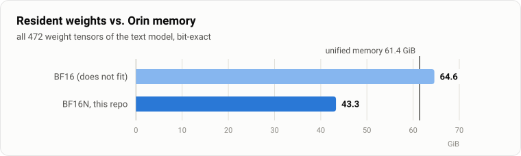
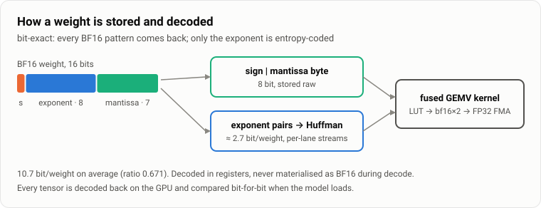
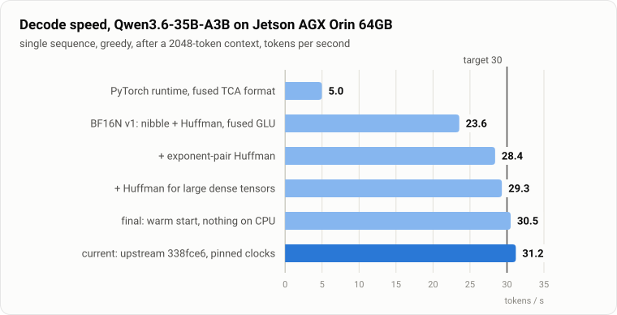
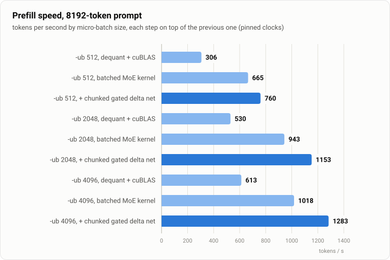
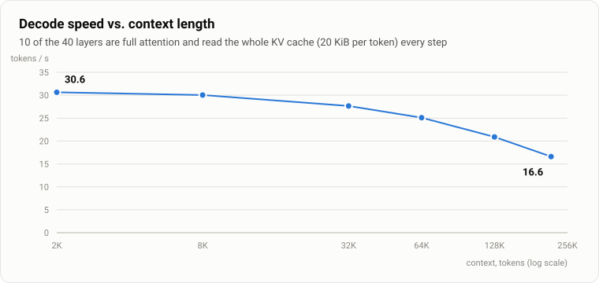
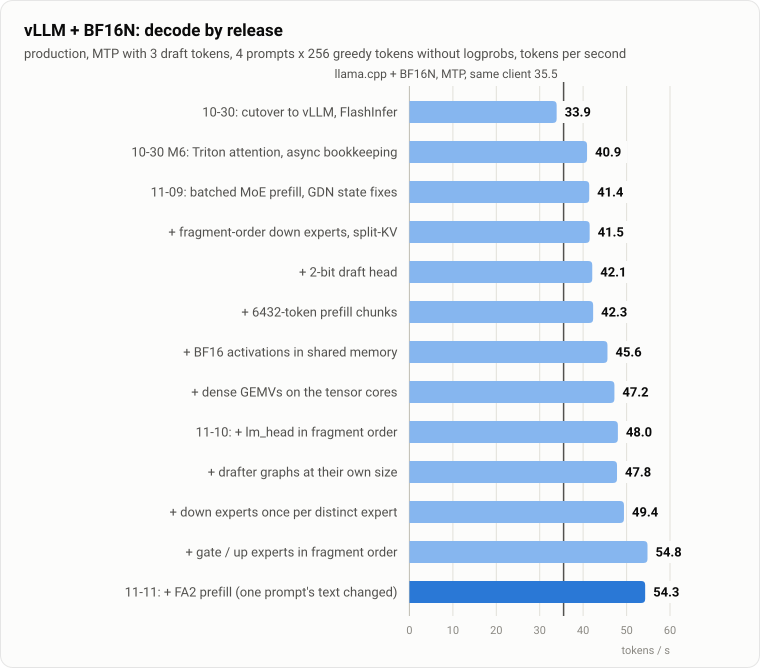
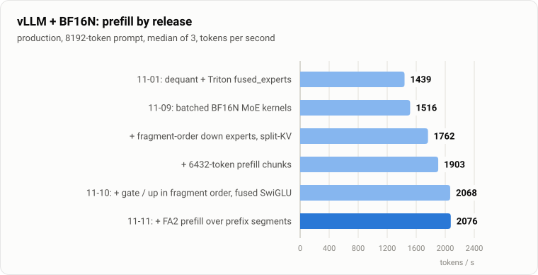
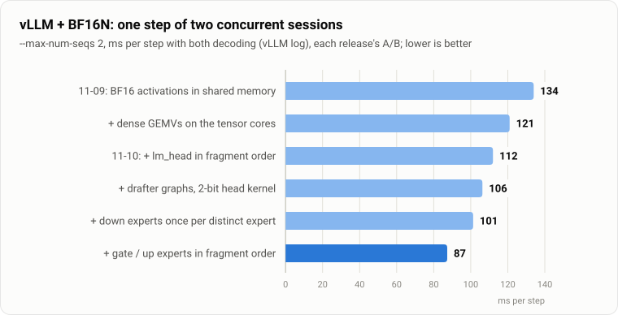

<h1 align="center">orin_qwen_lossless</h1>

<p align="center">
  <b>Bit-exact BF16 Qwen3.6-35B-A3B on a 64 GB Jetson: one format, two engines.<br>
  33 % less memory, every weight bit-identical; ≈ 31 tokens/s, and with the model's own MTP draft<br>
  ≈ 40 in llama.cpp and ≈ 55 in vLLM.</b>
</p>

<p align="center">
  
  
  
  
  
  
</p>

**Qwen3.6-35B-A3B** in BF16 needs 64.6 GiB, more than the 61.4 GiB of unified memory on an **NVIDIA Jetson AGX Orin
64GB**. The usual way out is quantisation, which changes the weights. This project keeps every weight bit-identical and
still makes the model fit. Its format, **BF16N**, entropy-codes only the part of a BF16 number that is compressible
(the exponent) and decodes it inside the matrix–vector kernels, so a decode step streams 33 % fewer bytes from DRAM.
One implementation of the format and kernels (`core/`) runs in two engines: **llama.cpp** (a patch series) and
**vLLM** (an out-of-tree plugin).

## Highlights

* **Lossless.** All 34.66 B weights round-trip bit-exactly, verified on the GPU for every tensor when the model loads,
  in both engines. Outputs follow each engine's stock BF16 path up to near-ties that any change of summation order can
  flip (see [Limitations](#limitations)).
* **Fits with room to spare.** 46.5 GB resident instead of 69.3 GB (ratio 0.671): the model's full 262,144-token window
  and its vision encoder fit beside the weights.
* **Fast.** ≈ 31 tok/s single-stream decode, 54.8 with the checkpoint's own multi-token-prediction layer as a
  speculative draft (vLLM; 40.2 in llama.cpp), 830–2070 tok/s prefill on a 60 W board. Per matrix, the fused decode+GEMV beats raw BF16: the
  248320×2048 output projection takes 4.3 ms vs 5.7 ms for cuBLAS BF16.
* **Two engines, one format.** llama.cpp: an ordinary BF16 GGUF and `LLAMA_BF16N=hybrid`; vLLM: the original
  safetensors and `--quantization bf16n`. Both serve the OpenAI-compatible API with text, images, tools and reasoning.
* **GPU only.** Embedding, weights and every model op run on the GPU; MoE experts are picked on the GPU, so the decode
  step stays in CUDA graphs.

<p align="center">
  <picture>
    <source media="(prefers-color-scheme: dark)" srcset="docs/img/memory-dark.svg">
    
  </picture>
</p>

## Comparison (BF16 only)

Both engines with BF16N on the same board (MAXN, pinned clocks). Decode is single-stream greedy; "same client" =
`bench/serving/bench_openai.py` (4 prompts × 256 tokens, with logprobs) against each server.

| | llama.cpp + BF16N | vLLM 0.20 + BF16N |
|---|---|---|
| weights resident | 46.5 GB (0.671), 472/472 tensors bit-exact at load | 45.8 GiB with the MTP layer and the BF16 vision encoder (43.5 + 1.0 + 0.9 at the 11-01 release; fragment-order padding since), every tensor bit-exact at load |
| decode, no draft, same client | 28.6 | 32.7 (FlashInfer, M2); 31.1 in the M6 configuration |
| decode with the MTP draft, same client | 35.5 (1 draft token) | 53.8 (3 draft tokens); **54.8** without logprobs |
| decode, `llama-bench` tg64 / `llama-server` MTP (4 × 400 tokens) | 31.2 / 40.2 | — |
| prefill 8k / 23k tokens | 832–1481 (`llama-bench`, ub 512–4096) / 1192 (server) | 2068 / 1885 (production config) |
| long-context decode (MTP) | 27.1 @ 64K, 22.6 @ 224K | 39.1 @ 72K, 32.0 @ 197K (11-09 haystack; step 66.9 / 84.0 ms) |
| two concurrent sessions | — | 87 ms per step, 30.6–36.4 tok/s each (68 % of one stream) |
| full 262,144 window + images | yes | yes (images capped at 4.19 MP) |
| uncompressed BF16, either engine | does not fit: 64.6 GiB > 61.4 GiB | same |

Stock BF16 kernels appear only where they can run: per matrix (lm_head 4.3 ms fused vs 5.7 ms cuBLAS BF16) and in
prefill, where BF16N's batched MoE kernel replaces exact dequant + stock kernels (2.4–2.7× over dequant + cuBLAS in
llama.cpp; 22 vs 29.5 ms per layer at 2048 tokens against Triton `fused_experts` in vLLM). Details:
[docs/RESULTS.md](docs/RESULTS.md).

## How it works

<p align="center">
  <picture>
    <source media="(prefers-color-scheme: dark)" srcset="docs/img/format-dark.svg">
    
  </picture>
</p>

A BF16 weight is `sign · 8-bit exponent · 7-bit mantissa`. Sign and mantissa are essentially random (7.86 of 8 bits of
entropy), the exponent is not (≈ 2.6 bits). So:

* **Sign and mantissa** stay raw, one byte per weight, laid out so a warp reads them with fully coalesced 16-byte loads.
* **Exponents** are coded in **pairs** of neighbouring weights with a length-limited Huffman code per tensor
  (≈ 2.7 bit/weight). One lookup in a 4096-entry table yields both exponents already in BF16 bit positions, so a single
  `lop3` with the sign|mantissa bytes produces two weights.
* Each warp owns a few rows and each lane decodes its own bitstream, so decoding runs in parallel with no escapes, no
  synchronisation and no intermediate BF16 copy. Small matrices, where entropy-coded units would starve the GPU, use a
  fixed-width 4-bit exponent code with a per-row table instead.
* Matrices are converted while the engine loads an ordinary BF16 checkpoint, checked bit-for-bit, and multiplied by
  fused kernels: decode GEMVs (also for routed experts and for several tokens at once, which makes the MTP draft pay),
  embedding lookups, and for prefill one persistent MoE kernel per matrix: routing on the GPU, each expert's weights
  decoded once per tile of routed tokens into shared memory and multiplied on the BF16 tensor cores, gate, up and
  SwiGLU fused. Dense matrices in prefill use exact dequantisation plus the stock BF16 GEMM.
* llama.cpp gets a new type `GGML_TYPE_BF16N` dispatched for `MUL_MAT`, `MUL_MAT_ID` and `GET_ROWS`; vLLM gets a
  quantization method that encodes layer by layer while loading and `torch.ops.bf16n` ops.

The full specification is in [docs/FORMAT.md](docs/FORMAT.md). Why the kernels look the way they do (the INT32 datapath
on GA10B, L1 behaviour, what did not work) is in [docs/llamacpp/RESULTS.md](docs/llamacpp/RESULTS.md) and
[docs/ORIN_NOTES.md](docs/ORIN_NOTES.md).

## llama.cpp results

<p align="center">
  <picture>
    <source media="(prefers-color-scheme: dark)" srcset="docs/img/decode-dark.svg">
    
  </picture>
</p>

Jetson AGX Orin Developer Kit 64GB, MAXN with GPU and CPU clocks pinned at maximum, CUDA 12.6, L4T R36.5,
`llama-bench -ngl 99 -fa 1`, single sequence.

| | |
|---|---|
| resident weights | **46.5 GB** of 69.3 GB (ratio 0.671), 472/472 tensors bit-exact |
| decode | **31.2 tok/s** at context 0 and at 2048 (±0.3 % between processes) |
| decode with the model's MTP head as a draft (`llama-server`, one draft token, 4 prompts × 400 tokens) | **40.2 tok/s** (+29 %, output unchanged: the model verifies every token) |
| prefill (8K prompt) | **832 tok/s** with the default `-ub 512`, **1323** with `-ub 2048`, **1481** with `-b 8192 -ub 4096` (2.4–2.7× the dequant + cuBLAS path) |
| server: full 262,144-token window, vision projector, MTP draft | 56.4–56.7 GB resident after a 3840×2160 image |
| previous best on this board, PyTorch runtime with a fused lossless format | 5.0 tok/s |
| BF16 without compression | does not fit |

<p align="center">
  <picture>
    <source media="(prefers-color-scheme: dark)" srcset="docs/img/prefill-dark.svg">
    
  </picture>
</p>

### Long context (llama.cpp)

<p align="center">
  <picture>
    <source media="(prefers-color-scheme: dark)" srcset="docs/img/context-dark.svg">
    
  </picture>
</p>

The model's full 262,144-token window fits next to the compressed weights. Decode slows down linearly with context
because the 10 full-attention layers read the whole F16 KV cache (20 KiB per token) at every step; the 30 Gated DeltaNet
layers keep a fixed-size state. The step time fits `32.3 ms + 0.118 µs × context`, i.e. attention streams the cache at
≈ 174 GB/s, close to the 180 GB/s the board reaches with plain reads.

| context | 2K | 8K | 32K | 64K | 128K | 224K |
|---|---:|---:|---:|---:|---:|---:|
| decode, tok/s | 30.6 | 30.0 | 27.7 | 25.1 | 20.9 | 16.6 |

2K–128K: `llama-bench -p 0 -n 32 -d <context> -ub 2048`, pinned clocks, desktop running. 224K: the server above with a
224,303-token prompt, which it prefilled at 648 tok/s on average (5.8 min) and answered correctly, with ≥ 3.8 GB free
throughout. With the MTP draft the server decodes 27.1 tok/s at 64K (free text; 25.1 without) and 22.6 tok/s at 224K
(a copy task; 16.8 without), and prefills the 224K prompt at 585 tok/s.

Correctness, methodology and the full history of what was tried: [docs/llamacpp/RESULTS.md](docs/llamacpp/RESULTS.md).

## vLLM results

<p align="center">
  <picture>
    <source media="(prefers-color-scheme: dark)" srcset="docs/img/vllm-decode-dark.svg">
    
  </picture>
</p>

Production on the board runs vLLM-BF16N with the shared core (since 2026-11-01): 262,144-token window, vision, MTP
with 3 draft tokens, prefix caching, tool and reasoning parsers. Each bar above is the production check after a
release (`bench_openai.py`, 4 prompts × 256 greedy tokens, without logprobs); every release kept the weights bit-exact
and was A/B-tested against the previous one on the same board before it shipped.

| production, 2026-11-10 (wheel `0.1.0+g5bde7a8faf58`) | |
|---|---|
| short-context decode, MTP 3 | **54.8 tok/s** (53.8 with logprobs) |
| long context (haystack, needle found) | 72K: prefill 1396 tok/s, decode 39.1; 197K: prefill 930, decode 32.0 (step 66.9 / 84.0 ms; decode speed follows the draft acceptance of the generated text, here 0.54 / 0.56) |
| prefill | 2068 tok/s at 8K, 1885 at 23K (6432-token chunks) |
| two concurrent sessions (`--max-num-seqs 2`) | 87 ms per step, 30.6–36.4 tok/s each: 68 % of one stream per session (goal: 80 %) |
| memory at the full window | ≥ 2.59 GiB free after a 4K image and a 246K request |
| output agreement (teacher-forced, 382–383 tokens) | top-1 99.74 %, mean KL 1.6e-3 against vLLM's exact-dequant reference path (stock torch kernels); 100 % / 2.1e-3 against llama.cpp-BF16N |

<p align="center">
  <picture>
    <source media="(prefers-color-scheme: dark)" srcset="docs/img/vllm-prefill-dark.svg">
    
  </picture>
</p>

<p align="center">
  <picture>
    <source media="(prefers-color-scheme: dark)" srcset="docs/img/vllm-streams-dark.svg">
    
  </picture>
</p>

What the releases of 2026-11-09/10 changed: batched BF16N kernels for every MoE prefill chunk; every routed expert
(down, then gate / up with the SwiGLU fused) in tensor-core fragment order and decoded once per distinct expert of a
verification batch; one split-KV program per multi-token sequence; a 2-bit draft-only candidate head; dense decode
GEMVs and lm_head on the tensor cores (8 tokens per weight decode); GDN state fixes; MTP drafter graphs at the
drafter's own row count; target sampling unmodified. Greedy texts change between releases at near ties (the
summation order changes), the weights never do.
The milestones, the step analysis, every release's A/B and what did not help: [docs/vllm/RESULTS.md](docs/vllm/RESULTS.md);
design and settings: [docs/vllm/README.md](docs/vllm/README.md).

## Quick start (on the Orin)

Pinned versions are in [`versions.env`](versions.env); `make` lists the build and test entry points.

### llama.cpp

```bash
git clone https://github.com/RobertKoval/orin_qwen_lossless && cd orin_qwen_lossless
engines/llamacpp/build.sh     # llama.cpp at the pinned commit + the BF16N patch series, built for SM87

# BF16 GGUFs of Qwen/Qwen3.6-35B-A3B: the language model (with its multi-token-prediction layer, 71 GB) and the
# vision projector
L=engines/llamacpp/src
python3 $L/convert_hf_to_gguf.py Qwen3.6-35B-A3B --outtype bf16 --outfile qwen3.6-35b-a3b-bf16.gguf
python3 $L/convert_hf_to_gguf.py Qwen3.6-35B-A3B --outtype bf16 --mmproj --outfile mmproj-bf16.gguf

# OpenAI-compatible server (/v1/chat/completions, images included) with the full 262,144-token window and the MTP
# layer as a speculative draft (+29 % decode; the full model verifies every token, so outputs stay its own)
LLAMA_BF16N=hybrid GGML_CUDA_VMM_POOL_GB=4 LLAMA_MTP_SWA=32768 LLAMA_MTP_VOCAB=65536 $L/build/bin/llama-server \
  -m qwen3.6-35b-a3b-bf16.gguf --mmproj mmproj-bf16.gguf -c 262144 -np 1 -ngl 99 -fa on --fit off \
  -b 2048 -ub 2048 -cram 0 --spec-type draft-mtp --spec-draft-n-max 1 --spec-draft-n-ubatch 2048 \
  --alias qwen3-a3b-30b --host 0.0.0.0 --port 8000
```

Loading reads the 71 GB GGUF and encodes it (≈ 3 min on the Orin's NVMe and CPU). What every flag is for, the
environment variables, the benchmarks and how the patch series is maintained: [docs/llamacpp/README.md](docs/llamacpp/README.md).

### vLLM

```bash
# in a vLLM 0.20 venv (JetPack 6, CUDA 12.6, torch 2.11; versions.env), from the original BF16 safetensors
TORCH_CUDA_ARCH_LIST=8.7 MAX_JOBS=4 pip install . --no-build-isolation --no-deps
export BF16N_CUDA_SCHED=yield VLLM_WORKER_MULTIPROC_METHOD=spawn
python3 -m vllm.entrypoints.openai.api_server --model /path/to/Qwen3.6-35B-A3B \
  --quantization bf16n --dtype bfloat16 --kv-cache-dtype auto --attention-backend TRITON_ATTN \
  --max-model-len 262144 --max-num-seqs 1 --max-num-batched-tokens 6432 --enable-chunked-prefill \
  --kv-cache-memory-bytes 6442450944 --gpu-memory-utilization 0.55 \
  --speculative-config '{"method":"mtp","num_speculative_tokens":3}' \
  --enable-prefix-caching --mamba-cache-mode align --mamba-block-size 8 \
  --enable-auto-tool-choice --tool-call-parser qwen3_coder --reasoning-parser qwen3 \
  --host 0.0.0.0 --port 8000 -O3
```

The first start encodes the checkpoint layer by layer (≈ 3 min; ready after ≈ 4 min once the compile is cached). The
board's vLLM 0.20 carries local patches (speculative decoding, attention, startup) whose sources are not distributed
here, so a stock vLLM 0.20 may need changes. Settings and knobs: [docs/vllm/README.md](docs/vllm/README.md).

## Reproduce

```bash
make test-core-host                                                      # encoder round trip, any host
make test-core test-vllm                                                 # GPU tests (Orin)
MODEL=qwen3.6-35b-a3b-bf16.gguf engines/llamacpp/tools/bench.sh          # llama-bench decode + prefill
MODEL=... bench/xengine/run_prompts.sh fast LLAMA_BF16N=hybrid           # greedy outputs + top-5 logprobs
MODEL=... bench/xengine/run_prompts.sh ref  LLAMA_BF16N=hybrid GGML_BF16N_REFERENCE=1
python3 bench/xengine/compare_outputs.py out/prompts-fast.json out/prompts-ref.json
python3 bench/serving/bench_openai.py <tag> <port> 256                   # decode, either engine (same client)
python3 bench/serving/bench_prefill.py <port> 5 2048,8192,23000          # prefill, either engine
python3 bench/xengine/compare_llama.py <vllm port> <tag>                 # vLLM vs the llama.cpp reference
python3 tools/charts/make_charts.py                                      # regenerate the figures
```

Every benchmark prompt comes from a frozen corpus (`bench/prompts/`, `python -m bench.prompts --sha`), so doc edits
never change the inputs behind a published number.

## Repository layout

| path | what |
|---|---|
| `core/` | the format: `include/bf16n/` (format, encoder API, kernels), `src/` (encoder, launchers), `torch/` (torch ops), host tests |
| `engines/llamacpp/` | patch series against the pinned llama.cpp, `build.sh`, ggml-linked benches |
| `engines/vllm/` | the `vllm_bf16n` plugin package, tools, benches |
| `tests/` | `core/` and `vllm/` (GPU pytest), `serving/` (clients against a running server, either engine) |
| `bench/` | `prompts/` (frozen inputs), `serving/`, `xengine/` (llama.cpp vs core / vLLM), `micro/` (kernel prototypes) |
| `tools/` | analysis, charts, Orin samplers |
| `docs/` | [FORMAT](docs/FORMAT.md), [RESULTS](docs/RESULTS.md), [ROADMAP](docs/ROADMAP.md), [ORIN_NOTES](docs/ORIN_NOTES.md), `llamacpp/`, `vllm/` |

## FAQ

**Is this quantisation?** No. Every BF16 bit pattern is reproduced exactly. In decode the products are FP32 FMAs of the
exact weights; in prefill, as in the engines' own BF16 paths, the activations are rounded to BF16 for the tensor cores and
accumulated in FP32. Only the order of the floating-point summation differs from the engines' own BF16 kernels, as it does
between any two GEMM implementations. The chunked gated delta net multiplies a two-part BF16 split of its FP32
operands (≈ 1e-5 relative error against FP64, vs ≈ 1e-6 for the FP32 recurrence); its effect on the next-token
distributions is the same size as changing the micro-batch size ([details](docs/llamacpp/RESULTS.md#prefill-chunked-gated-delta-net-upstream-kernel-ported)).

**Why not quantise?** 8- and 4-bit formats are smaller and faster, and they change the weights. This is for when you
want the reference model itself: evaluation baselines, quantisation research, regulated settings, or just not
wondering.

**Other models or GPUs?** The format is model-agnostic (any BF16 matrix whose rows are a multiple of 512 and at most 4096
wide); the policy and the kernels were tuned on Qwen3.6-35B-A3B and SM87. Other CUDA GPUs should work but are untested.
Discrete GPUs have more compute per byte of bandwidth, which should make the decode even cheaper there.

**How was it built?** By measuring. Microbenchmarks on real weights, SASS inspection, ablations and oracles (loads
replaced by register values to bound a gain), Nsight Compute where it decided between hypotheses (it needs root on
Jetson), and alternating A/B runs for every end-to-end change. [docs/llamacpp/RESULTS.md](docs/llamacpp/RESULTS.md) and [docs/vllm/RESULTS.md](docs/vllm/RESULTS.md) list
what worked, what did not, and by how much.

## Limitations

* Tested on one configuration: Qwen3.6-35B-A3B, Jetson AGX Orin 64GB (SM87), CUDA 12.6, llama.cpp `338fce6`, vLLM
  0.20.0 (with the board's local patches).
* llama.cpp: the compressed exponent buffers are allocated outside ggml's buffers, so llama.cpp's automatic memory fitting does not
  see them (≈ 11 GB); run with `--fit off` and set the context size explicitly.
* Not compressed: the vision encoder (0.9 GB BF16) and the KV cache (llama.cpp F16, where a lossless format would save
  ≈ 11 %, [details](docs/llamacpp/RESULTS.md#kv-cache-compressibility-measured-dropped); vLLM BF16, where an
  experimental reference codec saves ≈ 25 % on all ten layers up to 200K tokens, but attention reading it is slower on
  this GPU, [details](docs/RESULTS.md#experimental-bf16-kv-reference)).
* More draft tokens did not pay on this board when last measured: every extra verified token read its own 8 experts
  (≈ 8.3 ms per token in vLLM), so llama.cpp gains most with one draft token (+29 %,
  [details](docs/llamacpp/RESULTS.md#speculative-decoding-with-the-mtp-head)) and vLLM with three (four: 31.3 against
  41.1 tok/s, 10-30). vLLM's decode GEMVs now decode each distinct expert once per verification batch (about two of
  three routed experts are distinct in served text); four draft tokens have not been re-measured since. A
  block-diffusion drafter and a sliding window for the draft layer were evaluated and not adopted
  ([ROADMAP](docs/ROADMAP.md)).
* vLLM: the board's vLLM 0.20 carries local patches whose sources are not distributed here.
* Dense matrices in prefill are still dequantised to BF16 per micro-batch.
* Outputs are not bitwise equal across prefill kernels, micro-batch sizes, releases or engines: summation order moves
  next-token distributions by a mean KLD ≈ 0.002 (top-1 agreement ≈ 98.4 % on wikitext-2, perplexity unchanged), and
  greedy texts part at near ties. In vLLM the greedy texts of one build can also differ between server starts (two
  text sets; the trigger is measured, the mechanism is not identified:
  [fidelity boundaries](docs/vllm/README.md#fidelity-boundaries)). The weights are bit-exact either way; see
  [docs/llamacpp/RESULTS.md](docs/llamacpp/RESULTS.md).
* llama.cpp: the chunk-major expert layout that the prefill kernel needs costs 0.5 % of decode speed (gate/up GEMV 82 vs 80 µs).
* llama.cpp: the in-place recurrent-state read is only enabled for single-sequence batches (and not for the last recurrent layer,
  whose row index is freed before its kernel runs).

## Roadmap

Short-context decode runs its matrix–vector work at the DRAM limit of its access pattern (≈ 161–170 GB/s), so the
remaining headroom is in verifying several tokens per weight read, at long context and in prefill. Every routed
expert in vLLM is decoded straight into tensor-core fragments (down: 2.3× faster prefill kernel at 2048 tokens; gate /
up with the SwiGLU fused: 1.4×) and once per distinct expert of a verification batch. Next: two concurrent sessions at
80 % of one stream each (68 % now), then lossless KV coding so that two long windows fit (a lossless BF16 KV cache is
≈ 25 % smaller, but on this GPU attention reading it is slower than reading raw BF16, so it is not used for decode
yet). Expected gains and how each is measured: [docs/ROADMAP.md](docs/ROADMAP.md).

## License and credits

MIT ([LICENSE](LICENSE)); third-party notices in [THIRD_PARTY.md](THIRD_PARTY.md). Built on
[llama.cpp](https://github.com/ggml-org/llama.cpp) / ggml, [vLLM](https://github.com/vllm-project/vllm) and
[Qwen3.6-35B-A3B](https://huggingface.co/Qwen/Qwen3.6-35B-A3B). Related ideas: exponent entropy coding for lossless BF16
(DFloat11, ZipNN) and decoding inside the GEMM (ZipServ). The experimental KV reference is inspired by Guo et al.,
[GAAC](https://arxiv.org/abs/2610.38210); it is not the authors' implementation.
