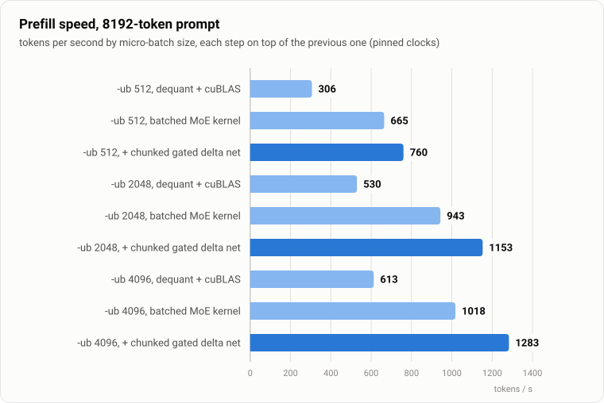

<h1 align="center">orin_qwen_lossless</h1>

<p align="center">
  <b>A 35B mixture-of-experts model in full BF16 precision on a 64 GB Jetson:<br>
  bit-exact weights, 33 % less memory, ≈ 30 tokens/s.</b>
</p>

<p align="center">
  
  
  
  
  
</p>

<p align="center">
  <picture>
    <source media="(prefers-color-scheme: dark)" srcset="docs/img/decode-dark.svg">
    
  </picture>
</p>

**Qwen3.6-35B-A3B** in BF16 needs 64.6 GiB, more than the 61.4 GiB of unified memory on an **NVIDIA Jetson AGX Orin
64GB**. The usual way out is quantisation, which changes the weights. This project keeps every weight bit-identical and
still makes the model fit. It entropy-codes only the part of a BF16 number that is compressible (the exponent) and
decodes it inside llama.cpp's CUDA matrix–vector kernels, so a decode step streams 33 % fewer bytes from DRAM.

## Highlights

* **Lossless.** All 34.66 B weights round-trip bit-exactly, verified on the GPU for every tensor when the model loads.
  Greedy generations follow llama.cpp's stock BF16 path up to near-ties that any change of summation order can flip
  (see [Limitations](#limitations)).
* **Fits with room to spare.** 46.5 GB resident instead of 69.3 GB (ratio 0.671), which leaves space for long contexts.
* **Fast.** ≈ 30 tok/s single-stream decode and 810–1430 tok/s prefill on a 60 W board. Per matrix, the fused
  decode+GEMV beats raw BF16: the 248320×2048 output projection takes 4.3 ms vs 5.7 ms for cuBLAS BF16.
* **GPU only.** Embedding, weights and every model op run on the GPU; MoE experts are picked on the GPU, so the decode
  step stays one CUDA graph.
* **Drop-in.** One patch on upstream llama.cpp, an ordinary BF16 GGUF and `LLAMA_BF16N=hybrid`. Tested with
  `llama-server` and `llama-bench`.

<p align="center">
  <picture>
    <source media="(prefers-color-scheme: dark)" srcset="docs/img/memory-dark.svg">
    
  </picture>
</p>

## How it works

<p align="center">
  <picture>
    <source media="(prefers-color-scheme: dark)" srcset="docs/img/format-dark.svg">
    
  </picture>
</p>

A BF16 weight is `sign · 8-bit exponent · 7-bit mantissa`. Sign and mantissa are essentially random (7.86 of 8 bits of
entropy), the exponent is not (≈ 2.6 bits). So:

* **Sign and mantissa** stay raw, one byte per weight, laid out so a warp reads them with fully coalesced 16-byte loads.
* **Exponents** are coded in **pairs** of neighbouring weights with a length-limited Huffman code per tensor
  (≈ 2.7 bit/weight). One lookup in a 4096-entry table yields both exponents already in BF16 bit positions, so a single
  `lop3` with the sign|mantissa bytes produces two weights.
* Each warp owns a few rows and each lane decodes its own bitstream, so decoding runs in parallel with no escapes, no
  synchronisation and no intermediate BF16 copy. Small matrices, where entropy-coded units would starve the GPU, use a
  fixed-width 4-bit exponent code with a per-row table instead.
* llama.cpp gets a new type `GGML_TYPE_BF16N`. Tensors are converted while an ordinary BF16 GGUF loads, checked
  bit-for-bit, and dispatched to the fused kernels for `MUL_MAT`, `MUL_MAT_ID` (MoE) and `GET_ROWS`.
* Prefill runs every MoE matrix as one persistent kernel: routing on the GPU, each expert's weights decoded once per tile
  of routed tokens into shared memory and multiplied on the BF16 tensor cores, with the next tile's decode started while
  the current one finishes. Gate, up and SwiGLU of the experts are one kernel; the lane streams reach it through small
  per-lane rings in shared memory filled by `cp.async`, so no warp waits on its own refill loads. Dense matrices in
  prefill use exact
  dequantisation plus the stock cuBLAS BF16 path. The gated delta net runs upstream llama.cpp's chunked tensor-core
  kernel (newer than `b29c606`, ported in the patch) instead of the token-by-token recurrence: 3.3 vs 15.8 ms per layer
  for 2048 tokens. Norms and F32→BF16 conversions also use upstream's newer kernels (fused RMS_NORM + SCALE, float4
  loads), which run at the board's bandwidth.

The full specification is in [docs/FORMAT.md](docs/FORMAT.md). Why the kernels look the way they do (the INT32 datapath on
GA10B, L1 behaviour, what did not work) is in [docs/RESULTS.md](docs/RESULTS.md) and [docs/ORIN_NOTES.md](docs/ORIN_NOTES.md).

## Results

Jetson AGX Orin Developer Kit 64GB, MAXN with GPU and CPU clocks pinned at maximum, CUDA 12.6, L4T R36.5,
`llama-bench -ngl 99 -fa 1`, single sequence.

| | |
|---|---|
| resident weights | **46.5 GB** of 69.3 GB (ratio 0.671), 472/472 tensors bit-exact |
| decode | **30.5 tok/s** at context 0 and at 2048 (±0.3 % between processes) |
| prefill (8K prompt) | **811 tok/s** with the default `-ub 512`, **1279** with `-ub 2048`, **1429** with `-b 8192 -ub 4096` (2.3–2.7× the dequant + cuBLAS path) |
| previous best on this board, PyTorch runtime with a fused lossless format | 5.0 tok/s |
| BF16 without compression | does not fit |

<p align="center">
  <picture>
    <source media="(prefers-color-scheme: dark)" srcset="docs/img/prefill-dark.svg">
    
  </picture>
</p>

### Long context

<p align="center">
  <picture>
    <source media="(prefers-color-scheme: dark)" srcset="docs/img/context-dark.svg">
    
  </picture>
</p>

The model's full 262,144-token window fits next to the compressed weights. Decode slows down linearly with context
because the 10 full-attention layers read the whole F16 KV cache (20 KiB per token) at every step; the 30 Gated DeltaNet
layers keep a fixed-size state. The step time fits `33.5 ms + 0.138 µs × context`, i.e. attention streams the cache at
≈ 149 GB/s, close to the board's 180 GB/s.

| context | 2K | 8K | 32K | 64K | 128K | 256K |
|---|---:|---:|---:|---:|---:|---:|
| decode, tok/s | 30.4 | 29.7 | 26.3 | 23.4 | 19.3 | 14.4 |

Measured before the clocks were pinned (see [docs/RESULTS.md](docs/RESULTS.md)); with pinned clocks the 2K point is 30.5.

Correctness, methodology and the full history of what was tried: [docs/RESULTS.md](docs/RESULTS.md).

## Quick start (on the Orin)

```bash
git clone https://github.com/RobertKoval/orin_qwen_lossless && cd orin_qwen_lossless
scripts/build_llama.sh        # clones llama.cpp b29c606, applies the patch, builds for SM87

# a BF16 GGUF of Qwen/Qwen3.6-35B-A3B (llama.cpp convert_hf_to_gguf.py --outtype bf16)
LLAMA_BF16N=hybrid ./llama.cpp/build/bin/llama-server -m qwen3.6-35b-a3b-bf16.gguf -ngl 99 -fa on -c 32768
```

Loading reads the 69 GB GGUF and encodes it (≈ 3–4 min on the Orin's NVMe and CPU). Run fully offloaded (`-ngl 99`).
For long prompts use larger micro-batches: `-ub 2048` lifts prefill from ≈ 810 to ≈ 1280 tok/s (measured with
`llama-bench`; it needs a larger compute buffer).
Close desktop applications for best speed: on Orin the compositor and remote desktop share the GPU and DRAM.

| variable | effect |
|---|---|
| `LLAMA_BF16N=hybrid` | enable (recommended): pair-Huffman for experts and large tensors, 4-bit codes for small ones |
| `LLAMA_BF16N=huffman` / `nibble` | one format for everything (experiments) |
| `LLAMA_BF16N_DENSE_MIN=<n>` | size threshold for entropy-coding dense tensors (default 8388608 weights) |
| `LLAMA_BF16N_INPUT_CPU=1` | keep the embedding on the CPU as upstream does |
| `GGML_BF16N_REFERENCE=1` | route every product through exact dequant + stock cuBLAS (slow; for verification) |
| `GGML_BF16N_NO_MMA=1` | prefill MoE through per-expert dequant + cuBLAS instead of the batched kernel |
| `GGML_CUDA_NO_GDN_ROWS=1` | disable the in-place recurrent-state read |
| `GGML_BF16N_HP_GLU=1` | fused gate/up/SWIGLU for pair-Huffman experts in decode (measured slower on Orin) |
| `GGML_BF16N_NO_GLU=1` | no gate/up/SWIGLU fusion at all (decode GEMV and prefill MoE kernel) |

## Reproduce

```bash
MODEL=qwen3.6-35b-a3b-bf16.gguf scripts/bench.sh                      # llama-bench decode + prefill
MODEL=... scripts/run_prompts.sh fast LLAMA_BF16N=hybrid                # greedy outputs + top-5 logprobs
MODEL=... scripts/run_prompts.sh ref  LLAMA_BF16N=hybrid GGML_BF16N_REFERENCE=1
python3 scripts/compare_outputs.py out/prompts-fast.json out/prompts-ref.json
python3 tools/make_charts.py                                            # regenerate the figures
# where a prefill forward goes: nsys of llama-bench, then the per-kernel split of the last forward
LLAMA_BF16N=hybrid nsys profile -t cuda -s none -o prof llama-bench -m $MODEL -ngl 99 -fa 1 -p 2048 -n 0 -b 2048 -ub 2048 -r 3
nsys export --type sqlite -o prof.sqlite prof.nsys-rep && python3 tools/fwd_breakdown.py prof.sqlite
```

Kernel microbenchmarks on real weights live in [`bench/`](bench): `bwprobe.cu` (DRAM read bandwidth), `nibble_gemv.cu` and
`hufpair_gemv.cu` (format + kernel; each checks its output bit-for-bit against a raw-BF16 kernel with the same summation
order), `locate_tensor.py`, `exponent_coverage.py`, and `kv_entropy.py` (lossless compressibility of a saved
llama-server KV cache). Build with `nvcc -O3 -arch=sm_87 -std=c++17 -o X bench/X.cu -lcublas`.

`moe_prefill.cpp` runs one BF16N `MUL_MAT_ID` of a real expert tensor through the patched ggml CUDA backend (any token
count, uniform or skewed routing), reports the median of individually synchronised repetitions after a 2 s GPU warm-up,
prints a hash of the output (equal hashes = bitwise equal results) and checks sampled (or all) output columns against a
CPU reference:

```bash
g++ -O2 -std=c++17 -I llama.cpp/ggml/include bench/moe_prefill.cpp -o moe_prefill \
    -L llama.cpp/build/bin -lggml -lggml-base -lggml-cuda -Wl,-rpath,$PWD/llama.cpp/build/bin
./moe_prefill qwen3.6-35b-a3b-bf16.gguf blk.20.ffn_gate_exps.weight 2048    # GGML_BF16N_NO_MMA=1: previous path
./moe_prefill qwen3.6-35b-a3b-bf16.gguf blk.20.ffn_down_exps.weight 4096 30 1 32768   # 30 reps, skewed, every column
./moe_prefill qwen3.6-35b-a3b-bf16.gguf blk.20.ffn_gate_up_exps.weight 2048 # gate + up + SWIGLU, fused vs unfused bitwise
```

`gdn_check.cpp` runs one gated delta net layer (model-like inputs, decay from the layer's own `ssm_a` and `dt_bias`)
through the same backend and compares outputs and final state with a double-precision recurrence:

```bash
g++ -O2 -std=c++17 -I llama.cpp/ggml/include bench/gdn_check.cpp -o gdn_check \
    -L llama.cpp/build/bin -lggml -lggml-base -lggml-cuda -Wl,-rpath,$PWD/llama.cpp/build/bin
./gdn_check qwen3.6-35b-a3b-bf16.gguf 0 2048        # layer 0, 2048 tokens; [reps] [1 = random initial state]
```

## FAQ

**Is this quantisation?** No. Every BF16 bit pattern is reproduced exactly. In decode the products are FP32 FMAs of the
exact weights; in prefill, as in llama.cpp's own BF16 path, the activations are rounded to BF16 for the tensor cores and
accumulated in FP32. Only the order of the floating-point summation differs from llama.cpp's own BF16 kernels, as it does
between any two GEMM implementations. The chunked gated delta net multiplies a two-part BF16 split of its FP32
operands (≈ 1e-5 relative error against FP64, vs ≈ 1e-6 for the FP32 recurrence); its effect on the next-token
distributions is the same size as changing the micro-batch size ([details](docs/RESULTS.md#prefill-chunked-gated-delta-net-upstream-kernel-ported)).

**Why not FP8 or 4-bit?** They are smaller and faster, and they change the model. This is for when you want the
reference model itself: evaluation baselines, quantisation research, regulated settings, or just not wondering.

**Other models or GPUs?** The format is model-agnostic (any BF16 matrix whose rows are a multiple of 512 and at most 4096
wide); the policy and the kernels were tuned on Qwen3.6-35B-A3B and SM87. Other CUDA GPUs should work but are untested.
Discrete GPUs have more compute per byte of bandwidth, which should make the decode even cheaper there.

**How was it built?** By measuring. Microbenchmarks on real weights, SASS inspection and ablations instead of a profiler
(ncu needs root on Jetson), and alternating A/B runs for every end-to-end change. [docs/RESULTS.md](docs/RESULTS.md) lists
what worked, what did not, and by how much.

## Limitations

* Tested on one configuration: Qwen3.6-35B-A3B, Jetson AGX Orin 64GB (SM87), CUDA 12.6, llama.cpp `b29c606`.
* The compressed exponent buffers are allocated outside ggml's buffers, so llama.cpp's automatic memory fitting does not
  see them (≈ 11 GB); set the context size explicitly.
* Dense matrices in prefill are still dequantised to BF16 per micro-batch.
* Outputs are deterministic for a given build and settings, but not bitwise equal across prefill kernels or micro-batch
  sizes: summation order moves next-token distributions by a mean KLD ≈ 0.002 (top-1 agreement ≈ 98.4 % on wikitext-2,
  perplexity unchanged). The weights are bit-exact either way; see [docs/RESULTS.md](docs/RESULTS.md).
* The chunk-major expert layout that the prefill kernel needs costs 0.5 % of decode speed (gate/up GEMV 82 vs 80 µs).
* The in-place recurrent-state read is only enabled for single-sequence batches.

## Roadmap

Decode sits at ≈ 67 % of what this format allows on the board (≈ 45 tok/s at 180 GB/s); prefill still has headroom in the
MoE kernel (53 % of a 2048-token forward; decode and tensor-core products overlap only partly, and gate, up and
SwiGLU are three passes over the expert activations).
The next research stages, with expected gains and how to measure them, are in [docs/ROADMAP.md](docs/ROADMAP.md).

## License and credits

MIT, same as llama.cpp ([LICENSE](LICENSE)). Built on [llama.cpp](https://github.com/ggml-org/llama.cpp) / ggml and
[Qwen3.6-35B-A3B](https://huggingface.co/Qwen/Qwen3.6-35B-A3B). Related ideas: exponent entropy coding for lossless BF16
(DFloat11, ZipNN) and decoding inside the GEMM (ZipServ).
