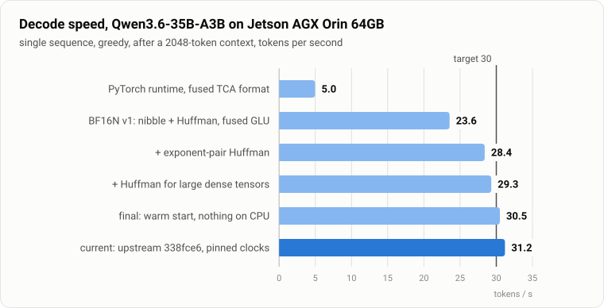
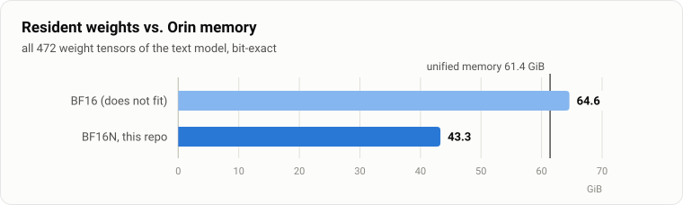
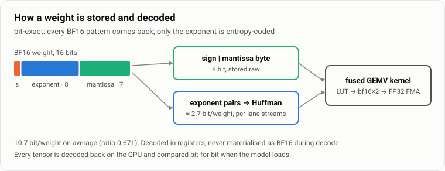
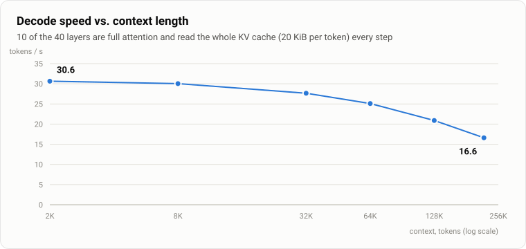

<h1 align="center">orin_qwen_lossless</h1>

<p align="center">
  <b>A 35B mixture-of-experts model in full BF16 precision on a 64 GB Jetson:<br>
  bit-exact weights, 33 % less memory, ≈ 30 tokens/s.</b>
</p>

<p align="center">
  
  
  
  
  
</p>

<p align="center">
  <picture>
    <source media="(prefers-color-scheme: dark)" srcset="docs/img/decode-dark.svg">
    
  </picture>
</p>

**Qwen3.6-35B-A3B** in BF16 needs 64.6 GiB, more than the 61.4 GiB of unified memory on an **NVIDIA Jetson AGX Orin
64GB**. The usual way out is quantisation, which changes the weights. This project keeps every weight bit-identical and
still makes the model fit. It entropy-codes only the part of a BF16 number that is compressible (the exponent) and
decodes it inside llama.cpp's CUDA matrix–vector kernels, so a decode step streams 33 % fewer bytes from DRAM.

## Highlights

* **Lossless.** All 34.66 B weights round-trip bit-exactly, verified on the GPU for every tensor when the model loads.
  Greedy generations match llama.cpp's stock BF16 path token for token.
* **Fits with room to spare.** 46.5 GB resident instead of 69.3 GB (ratio 0.671), which leaves space for long contexts.
* **Fast.** ≈ 30 tok/s single-stream decode and ≈ 305 tok/s prefill on a 60 W board. Per matrix, the fused
  decode+GEMV beats raw BF16: the 248320×2048 output projection takes 4.3 ms vs 5.7 ms for cuBLAS BF16.
* **GPU only.** Embedding, weights and every model op run on the GPU; MoE experts are picked on the GPU, so the decode
  step stays one CUDA graph.
* **Drop-in.** One patch on upstream llama.cpp, an ordinary BF16 GGUF and `LLAMA_BF16N=hybrid`. Tested with
  `llama-server` and `llama-bench`.

<p align="center">
  <picture>
    <source media="(prefers-color-scheme: dark)" srcset="docs/img/memory-dark.svg">
    
  </picture>
</p>

## How it works

<p align="center">
  <picture>
    <source media="(prefers-color-scheme: dark)" srcset="docs/img/format-dark.svg">
    
  </picture>
</p>

A BF16 weight is `sign · 8-bit exponent · 7-bit mantissa`. Sign and mantissa are essentially random (7.86 of 8 bits of
entropy), the exponent is not (≈ 2.6 bits). So:

* **Sign and mantissa** stay raw, one byte per weight, laid out so a warp reads them with fully coalesced 16-byte loads.
* **Exponents** are coded in **pairs** of neighbouring weights with a length-limited Huffman code per tensor
  (≈ 2.7 bit/weight). One lookup in a 4096-entry table yields both exponents already in BF16 bit positions, so a single
  `lop3` with the sign|mantissa bytes produces two weights.
* Each warp owns a few rows and each lane decodes its own bitstream, so decoding runs in parallel with no escapes, no
  synchronisation and no intermediate BF16 copy. Small matrices, where entropy-coded units would starve the GPU, use a
  fixed-width 4-bit exponent code with a per-row table instead.
* llama.cpp gets a new type `GGML_TYPE_BF16N`. Tensors are converted while an ordinary BF16 GGUF loads, checked
  bit-for-bit, and dispatched to the fused kernels for `MUL_MAT`, `MUL_MAT_ID` (MoE) and `GET_ROWS`; prefill uses exact
  dequantisation plus the stock cuBLAS BF16 path.

The full specification is in [docs/FORMAT.md](docs/FORMAT.md). Why the kernels look the way they do (the INT32 datapath on
GA10B, L1 behaviour, what did not work) is in [docs/RESULTS.md](docs/RESULTS.md) and [docs/ORIN_NOTES.md](docs/ORIN_NOTES.md).

## Results

Jetson AGX Orin Developer Kit 64GB, MAXN, CUDA 12.6, L4T R36.5, `llama-bench -ngl 99 -fa 1`, single sequence.

| | |
|---|---|
| resident weights | **46.5 GB** of 69.3 GB (ratio 0.671), 472/472 tensors bit-exact |
| decode | **29.8 tok/s** at context 0, **30.5 tok/s** at 2048 (±0.3 % over 3 processes; +0.5 % with the desktop stopped) |
| prefill | **305–311 tok/s** on a 2K prompt; on an 8K prompt **265 tok/s** with the default `-ub 512`, **502 tok/s** with `-b 4096 -ub 4096` |
| previous best on this board, PyTorch runtime with a fused lossless format | 5.0 tok/s |
| BF16 without compression | does not fit |

### Long context

<p align="center">
  <picture>
    <source media="(prefers-color-scheme: dark)" srcset="docs/img/context-dark.svg">
    
  </picture>
</p>

The model's full 262,144-token window fits next to the compressed weights. Decode slows down linearly with context
because the 10 full-attention layers read the whole F16 KV cache (20 KiB per token) at every step; the 30 Gated DeltaNet
layers keep a fixed-size state. The step time fits `33.5 ms + 0.138 µs × context`, i.e. attention streams the cache at
≈ 149 GB/s, close to the board's 180 GB/s.

| context | 2K | 8K | 32K | 64K | 128K | 256K |
|---|---:|---:|---:|---:|---:|---:|
| decode, tok/s | 30.4 | 29.7 | 26.3 | 23.4 | 19.3 | 14.4 |

Correctness, methodology and the full history of what was tried: [docs/RESULTS.md](docs/RESULTS.md).

## Quick start (on the Orin)

```bash
git clone https://github.com/RobertKoval/orin_qwen_lossless && cd orin_qwen_lossless
scripts/build_llama.sh        # clones llama.cpp b29c606, applies the patch, builds for SM87

# a BF16 GGUF of Qwen/Qwen3.6-35B-A3B (llama.cpp convert_hf_to_gguf.py --outtype bf16)
LLAMA_BF16N=hybrid ./llama.cpp/build/bin/llama-server -m qwen3.6-35b-a3b-bf16.gguf -ngl 99 -fa on -c 32768
```

Loading reads the 69 GB GGUF and encodes it (≈ 3–4 min on the Orin's NVMe and CPU). Run fully offloaded (`-ngl 99`).
For long prompts, larger micro-batches amortise the prefill dequantisation: `-b 4096 -ub 4096` nearly doubles prefill
speed (measured with `llama-bench`; it needs a larger compute buffer).
Close desktop applications for best speed: on Orin the compositor and remote desktop share the GPU and DRAM.

| variable | effect |
|---|---|
| `LLAMA_BF16N=hybrid` | enable (recommended): pair-Huffman for experts and large tensors, 4-bit codes for small ones |
| `LLAMA_BF16N=huffman` / `nibble` | one format for everything (experiments) |
| `LLAMA_BF16N_DENSE_MIN=<n>` | size threshold for entropy-coding dense tensors (default 8388608 weights) |
| `LLAMA_BF16N_INPUT_CPU=1` | keep the embedding on the CPU as upstream does |
| `GGML_BF16N_REFERENCE=1` | route every product through exact dequant + stock cuBLAS (slow; for verification) |
| `GGML_CUDA_NO_GDN_ROWS=1` | disable the in-place recurrent-state read |
| `GGML_BF16N_HP_GLU=1` | fused gate/up/SWIGLU for pair-Huffman experts (measured slower on Orin) |

## Reproduce

```bash
MODEL=qwen3.6-35b-a3b-bf16.gguf scripts/bench.sh                      # llama-bench decode + prefill
MODEL=... scripts/run_prompts.sh fast LLAMA_BF16N=hybrid                # greedy outputs + top-5 logprobs
MODEL=... scripts/run_prompts.sh ref  LLAMA_BF16N=hybrid GGML_BF16N_REFERENCE=1
python3 scripts/compare_outputs.py out/prompts-fast.json out/prompts-ref.json
python3 tools/make_charts.py                                            # regenerate the figures
```

Kernel microbenchmarks on real weights live in [`bench/`](bench): `bwprobe.cu` (DRAM read bandwidth), `nibble_gemv.cu` and
`hufpair_gemv.cu` (format + kernel; each checks its output bit-for-bit against a raw-BF16 kernel with the same summation
order), `locate_tensor.py`, `exponent_coverage.py`. Build with `nvcc -O3 -arch=sm_87 -std=c++17 -o X bench/X.cu -lcublas`.

## FAQ

**Is this quantisation?** No. Every BF16 bit pattern is reproduced exactly; the products are FP32 FMAs of the exact
weights. Only the order of the floating-point summation differs from llama.cpp's own BF16 kernels, as it does between any
two GEMV implementations.

**Why not FP8 or 4-bit?** They are smaller and faster, and they change the model. This is for when you want the
reference model itself: evaluation baselines, quantisation research, regulated settings, or just not wondering.

**Other models or GPUs?** The format is model-agnostic (any BF16 matrix whose rows are a multiple of 512 and at most 4096
wide); the policy and the kernels were tuned on Qwen3.6-35B-A3B and SM87. Other CUDA GPUs should work but are untested.
Discrete GPUs have more compute per byte of bandwidth, which should make the decode even cheaper there.

**How was it built?** By measuring. Microbenchmarks on real weights, SASS inspection and ablations instead of a profiler
(ncu needs root on Jetson), and alternating A/B runs for every end-to-end change. [docs/RESULTS.md](docs/RESULTS.md) lists
what worked, what did not, and by how much.

## Limitations

* Tested on one configuration: Qwen3.6-35B-A3B, Jetson AGX Orin 64GB (SM87), CUDA 12.6, llama.cpp `b29c606`.
* The compressed exponent buffers are allocated outside ggml's buffers, so llama.cpp's automatic memory fitting does not
  see them (≈ 11 GB); set the context size explicitly.
* Prefill dequantises each used expert to BF16 and synchronises once per MoE layer; it is correct but not optimised.
* The in-place recurrent-state read is only enabled for single-sequence batches.

## Roadmap

Decode sits at ≈ 67 % of what this format allows on the board (≈ 45 tok/s at 180 GB/s); prefill has the most headroom.
The next research stages, with expected gains and how to measure them, are in [docs/ROADMAP.md](docs/ROADMAP.md).

## License and credits

MIT, same as llama.cpp ([LICENSE](LICENSE)). Built on [llama.cpp](https://github.com/ggml-org/llama.cpp) / ggml and
[Qwen3.6-35B-A3B](https://huggingface.co/Qwen/Qwen3.6-35B-A3B). Related ideas: exponent entropy coding for lossless BF16
(DFloat11, ZipNN) and decoding inside the GEMM (ZipServ).
